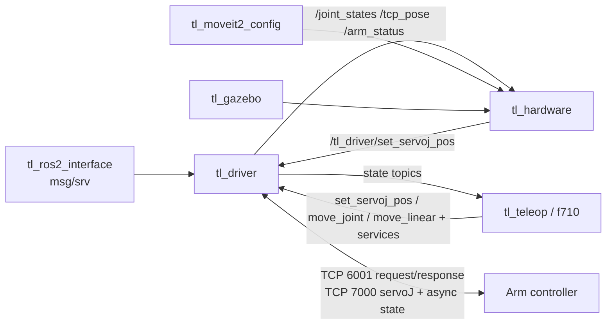

# Repository Guidelines

> 本文件只记录「不知道就会做错」的硬约束与导航地图；使用说明见 `README.md`，逐包说明见各包 `README.md`，接口逐条说明见 `src/tl_driver/doc/tl_driver接口说明书.md`。

天链（TL）系列机械臂 ROS2 工作空间。目标环境 **Ubuntu 22.04 + ROS2 Humble + 控制器 2403**；C++17 / ament_cmake / colcon，无 ament_python 包、无前端。支持 14 种臂型（`tcb605`…`tcb710v`）。

## Project Overview

提供机械臂的完整 ROS2 接入栈：

- **驱动层**：`tl_driver` 通过 TCP 连接控制器（NexMotion SDK `libtl_host.so`），把 SDK 的 mm/度接口适配为 REP 103（m/rad）的 ROS 话题与服务。
- **控制/仿真层**：`tl_hardware`（ros2_control 插件）、`tl_moveit2_config`（14 套 MoveIt2 配置）、`tl_gazebo`、`tl_description`。
- **遥操作层**：`tl_teleop`（PXREA VR SDK）、`tl_teleop_f710`（手柄 + Gazebo 桥接）。
- **接口与示例**：`tl_ros2_interface` 定义全部自定义 msg/srv；`tl_example` 是实机验收示例。

工作空间共 **9 个顶层包 + 14 个 MoveIt2 配置子包**（`src/tl_moveit2_config/` 只是容器目录，自身无 `package.xml`）。

## Architecture & Data Flow



核心事实：

- **双端口**：`arm_port` 6001 用于请求/响应式 SDK 调用；`arm_port_aux` 7000 用于 servoJ 全系列 + 机器人状态异步推送。两个 fd 都必须连通，状态回调只在 aux 注册，错误/告警回调只在主端口 6001 注册（7000 不注册）。
- **`tl_driver` 组成**：`DriverNode` 只做参数、回调组、实体创建；服务按域拆在 `src/node/services_*.cpp`，由 `src/node/registrars.hpp` 的 `register_*` 函数注册；话题在 `topics.cpp`，action 在 `actions_motion.cpp`。当前规模：**35 个服务、1 个订阅、5 个发布、3 个 action**。`arm_client::ArmClient` 进程内只允许一个实例（SDK 回调无 userdata）；状态帧/错误日志走 rclcpp 并 1 s 节流。
- **发布**：`/joint_states`（rad）、`/tcp_pose`（m/rad）跟随 7000 帧率；`/arm_status`（`STOP`/`PAUSE`/`RUNNING` + `speed`/`speed_valid`）随 10 Hz 运行状态查询发布；`/tl_driver/joint_dynamics`（10 Hz）、`/tl_driver/joint_thermal`（1 Hz）。数字 IO 不发布话题，读写统一走 `get_digital_input_output` / `set_digital_output` 服务。`/joint_states`、`/tcp_pose` 由 7000 端口 ACS/MCS 连续帧**通知独立发布线程**发布，不经过执行器；状态流失效时话题停更，1 Hz 看门狗重发 `mode=1`（无 `state_source=poll` 回退）。诊断话题为定长数组 + NaN 无效语义。`StatePublishers` 复用成员缓冲与消息，**勿在发布回调内新建 vector/message**；ServoJ 日志不得逐帧 INFO。
- **订阅**：`/tl_driver/set_servoj_pos`（rad，6 或 7 元素，6 元素末尾补 0；转发 SDK 时为固定 7 元素）。一次性运动统一走 `move_joint` / `move_linear` action；完成/失败以 action result 为准，`/arm_status` 仅用于运行状态与进度观察。
- **线程模型**：`MultiThreadedExecutor` 线程数由 `executor_threads` 参数决定（默认 `max(4, min(hardware_concurrency, 8))`，范围 1–64），固定 8 个 `MutuallyExclusive` 回调组：`service_group_`（session/config/io/state/transform 短服务）、`motion_service_group_`（jogging/track/queue/servo）、`topic_group_`、`stream_group_`、`dynamics_group_`、`thermal_group_`、`status_group_`、`action_group_`。`status_group_` 跑 10 Hz 运行状态查询与 1 Hz 速度查询，并发布 `/arm_status`；`/joint_states`、`/tcp_pose` 的发布在独立 `std::thread`（7000 帧通知），不在执行器内。
- **失败即退**：`DriverNode::init()` 连接失败或切入示教模式失败时抛异常，由 `tl_driver_main.cpp` 捕获后返回 `EXIT_FAILURE`（析构会断开已建立的端口），不带病运行。
- **硬件插件**：`TLHardwareInterface` 生命周期 `on_init → on_configure → on_activate → …`；`on_activate` 用当前关节位置初始化命令，避免跳到零位；`write()` 发 `/tl_driver/set_servoj_pos`。

### 单位与长度契约（改动必查两端）

ROS 侧统一 REP 103（m / rad / rad/s），控制器/SDK 侧 mm / 度 / %，换算集中在 `src/tl_driver/src/convert/units.hpp` 与边界代码。欧拉角为 **XYZ 内旋**（scipy `'XYZ'`）。

| 通道 | 单位 |
|---|---|
| `/joint_states.position` | rad |
| `/tcp_pose.position` / `.rpy` | m / rad |
| `/tl_driver/set_servoj_pos` | rad（6 或 7 元素；6→7 末尾补 0，SDK 侧固定 7 元素） |
| `MoveCommand.target_pos_value` | `coord=0` 关节 rad；`1/2/3` 为 m + 姿态 rad |
| `MoveCommand.velocity` | MOVJ 为 %；MOVL 为 m/s |
| `ToolParam` / `SetUserCoord` | m + rad；`payload_mass` kg |
| `OpenServoJ.vmax/amax/jmax` | rad/s、rad/s²、rad/s³ |
| `RobotDHParam` / `RobotJointParam` | rad、m；转速 rad/s；角加速度 rad/s² |
| `GetCurrentLineJointSpeed` | m/s / rad/s |

- 命令入参：关节/位姿向量对 6 轴**补 0 到 7 位，不是截断**；`MoveCmd::targetPosValue` 为 **14 位**（前 7 本体 + 后 7 外部轴）。`/joint_states` 输出相反：6 轴只发 6 个位置（丢弃 SDK 的第 7 位）。
- `GetPosReachable` 的 `pos` 是 **14 位**控制器协议包（`[1]` 为单位制标志位），**按协议原样透传，驱动不换算**。
- 消费方（`tl_teleop`、`tl_teleop_f710_node`、`tl_teleop_f710_sim_bridge`、`tl_hardware_interface`）**直接收发 REP 103 值**，不再做 m↔mm / rad↔度换算（`ab3f2b6`）；仅配置中的度值在读取时转 rad。
- 历史事故：`/tcp_pose` 的 m↔mm 误用曾使 IK 目标差 1000 倍，控制器报 9754「目标位置不可达」。

## Key Directories

| 路径 | 用途 |
|---|---|
| `src/tl_ros2_interface/` | 11 个 `.msg` + 2 个 `.action` + 26 个 `.srv`，**必须最先构建**。`msg/` 不等于话题清单：4 个话题载荷、1 个 action goal 载荷（`MoveCommand`）、6 个仅作 srv 嵌套参数 |
| `src/tl_driver/` | 驱动节点。`src/tl_driver_main.cpp`（入口）、`src/node/`（参数/回调组/注册）、`src/arm_session.*`、`src/arm_client.*`、`lib/`（预编译 SDK，只读） |
| `src/tl_hardware/` | ros2_control `SystemInterface` 插件 |
| `src/tl_teleop/` | VR 遥操作，100 Hz 控制线程；`lib/` 为 PXREA SDK，只读 |
| `src/tl_teleop_f710/` | F710 手柄遥操作 + `sim_bridge`（250 Hz ServoJ） |
| `src/tl_description/` | URDF/xacro、STL、RViz（纯数据包） |
| `src/tl_bringup/launch/` | 14 个 `tl_<arm_type>_bringup.launch.py` |
| `src/tl_gazebo/` | Gazebo + ros2_control 仿真 |
| `src/tl_moveit2_config/` | 14 个 `tl_<arm_type>_config` 子包 |
| `src/tl_example/` | 8 个示例可执行程序 + `scripts/servoj_test.py` |
| `scripts/` | 格式化、Release 说明、工作空间测量 |
| `.github/workflows/` | `ci.yml`（格式检查）、`release.yml`（打标签发布） |

## Development Commands

```bash
# 全量构建
colcon build --cmake-args -DCMAKE_EXPORT_COMPILE_COMMANDS=ON
source install/setup.bash

# 选择性构建（先建接口包）
colcon build --packages-select tl_ros2_interface
colcon build --packages-up-to tl_driver

# 格式化（提交前必跑）
./scripts/format-cpp.sh
black .

# 测试（只有 tl_driver 有自动化测试）
colcon test --packages-select tl_driver
colcon test-result --verbose

# 运行的三种方式
ros2 launch tl_bringup tl_tcb610_bringup.launch.py          # 实机
ros2 launch tl_tcb610_config demo.launch.py                 # MoveIt2 + RViz
ros2 launch tl_gazebo gazebo_tcb610_demo.launch.py          # Gazebo
```

依赖顺序：`tl_ros2_interface` → `tl_driver` / `tl_hardware` / `tl_teleop` / `tl_teleop_f710` / `tl_example`；`tl_description` → `tl_gazebo` 与全部 `tl_*_config`。`tl_bringup` 运行时用 `get_package_share_directory()` 解析，不声明构建依赖，但未构建时 launch 会失败。

## Code Conventions & Common Patterns

### 命名

| 对象 | 规则 |
|---|---|
| 文件 | `snake_case` |
| 类 / 枚举 | `PascalCase` |
| 枚举值 / 宏 | `UPPER_SNAKE` |
| 成员变量 | `snake_case_`（下划线后缀） |
| 成员函数 | `camelCase` |
| 服务回调 / 话题回调 | `handle_{name}_service` / `handle_{topic}_topic` |
| 句柄 | `{name}_service_` / `_sub_` / `_pub_` |
| 头文件保护 | `包名__文件名_HPP_` |
| 话题 / 服务 | snake_case，驱动侧统一 `/tl_driver/` 前缀 |
| Python | 文件/函数/变量 snake_case，类 PascalCase；客户端 `_cli`、订阅 `_sub` |

已知历史例外，勿“顺手修正”：`poweron_service_` → `/tl_driver/power_on`；`poweroff_service_` → `/tl_driver/power_off`；`running_status_pub_` → `/arm_status`。

### C++ 模式

- **SDK 调用**：一律 `tl::` 显式限定，**禁止 `using namespace tl`**（unscoped enum 会与其他符号冲突）；SDK 返回值用其自身类型（如 `tl::Result`），失败路径统一 `result_to_string(ret)` 记录。
- **服务响应**：每个 handler 先检查连接状态，失败返回 `{success=false, message="Arm is not connected"}`；业务失败同样返回 `{success, message}`，不抛异常。
- **注册模式**：`DriverNode` 不内联 handler；每个域文件暴露一个 `register_*`，handler 放匿名 namespace，用 `std::bind(&Class::method, this, ...)` 绑定。
- **实体保活**：基类 `create_service` / `create_subscription` 包装会把句柄存入 `services_` / `subscriptions_`，否则 Humble 下会被注销。
- **话题回调**：`set_servoj_pos` 只做补 0、rad→度与转发。
- **遥操作线程**：`tl_teleop` 主线程 `SingleThreadedExecutor` + 独立 `std::thread` 跑 100 Hz 控制循环；SIGINT handler 延迟 shutdown 直到 `close_servo` 完成。
- **单位换算**：驱动侧集中在 `convert/`，消费方直接使用 REP 103（配置中的度值在读取时转 rad）；新增接口同时确认 ROS 侧与控制器侧。
- **配置边界**：臂型相关取值（IP/端口/关节名）放 `config/*.yaml`；`declare_parameter` 与 launch 中保留兜底默认值（`192.168.1.13:6001`、aux `7000`）。
- **`arm_type` 大小写**：配置 YAML 用大写（`TCB605`），launch 参数用小写（`tcb605`）。

### 文档同步（同一提交内）

| 变更 | 必须同步 |
|---|---|
| msg/srv/话题/服务/action 增删改 | `CHANGELOG.md` + `src/tl_driver/doc/tl_driver接口说明书.md` |
| launch / 参数 / YAML | 对应包 `README.md` |
| 增删功能包、依赖 | `CHANGELOG.md` + 包表 + 该包 `README.md` |
| 用户可见修复、SDK 升级、新臂型、行为变更 | `CHANGELOG.md` |
| 构建命令、命名规范、关键话题、臂型表 | 本文件 |
| 动到被文档引用的路径/名称/命令 | 修正所有引用处 |

## Important Files

| 文件 | 作用 |
|---|---|
| `src/tl_driver/src/tl_driver_main.cpp` | 驱动入口；`MultiThreadedExecutor` 线程数 |
| `src/tl_driver/src/node/driver_node.{hpp,cpp}` | 参数、回调组、实体创建、`init()` 失败即退 |
| `src/tl_driver/src/node/registrars.hpp` | 7 个注册函数声明（6 个服务域 + topics） |
| `src/tl_driver/src/node/services_*.cpp` / `topics.cpp` / `publishers.cpp` / `actions_motion.cpp` | 服务、订阅、发布、action 实现 |
| `src/tl_driver/src/arm_session.{hpp,cpp}` / `arm_client.{hpp,cpp}` | 会话、SDK 薄封装与双通道状态快照 |
| `src/tl_driver/src/convert/units.hpp` / `msg_convert.cpp` / `state_frame.cpp` | 单位、消息与状态帧 JSON 换算/解析 |
| `src/tl_driver/config/*.yaml` | 各臂型 IP、端口、关节名 |
| `src/tl_hardware/src/tl_hardware_interface.cpp` | ros2_control 插件实现 |
| `src/tl_teleop/src/tl_teleop.cpp` | VR 遥操作与 100 Hz 循环 |
| `src/tl_teleop_f710/src/tl_teleop_f710_node.cpp` / `_sim_bridge.cpp` | 手柄控制与仿真桥接 |
| `scripts/format-cpp.sh` / `scripts/release-notes.sh` | CI 使用的格式化与发布说明脚本 |
| `.github/workflows/ci.yml` / `release.yml` | 格式检查 / 打标签发布 |

## Runtime/Tooling Preferences

- **运行时**：ROS2 Humble、Ubuntu 22.04、控制器固件 2403；开发在 Docker 内（配置不在本仓库）。
- **构建**：`colcon` + `ament_cmake`，C++17，`-Wall -Wextra -Wpedantic`；无 `ament_python` 包。
- **SDK 只读**：`src/tl_driver/lib/` 与 `src/tl_teleop/lib/` 是随包发布的预编译产物，**不修改、不格式化**；`format-cpp.sh` 已跳过 `lib/include/`。SDK 头可直接读：`src/tl_driver/lib/include/tl_interface.h`、`tl_types.h`。
- **格式化工具版本**：CI 固定 `clang-format==14.0.6`、`black==26.5.1`；本地保持一致，避免版本漂移误报。
- **C++ 风格**：`.clang-format` 基于 Google，Allman 大括号、2 空格、120 列、`SortIncludes: false`。
- **Python 风格**：`pyproject.toml`，black/ruff/isort 均 100 列；isort/ruff **不在 CI**，只有 black 强制。
- **CI 只做格式检查**：`ci.yml` 不编译、不跑测试；纯 `.md` / `docs/**` 提交不触发。改了 C++ 必须本地 `colcon build`。
- **Release**：标签须匹配 `[vV]?主.次.补[-(rc|beta)N]` 且提交是远端 `master`/`dev` 祖先，否则静默跳过；说明取自 `CHANGELOG.md` 对应章节，缺失即失败。发版顺序：推分支等 CI 绿 → `git tag Vx.y.z` → `git push origin Vx.y.z`。

## Testing & QA

- **自动化测试仅覆盖 `tl_driver` 的纯逻辑层**：3 个 gtest 二进制、20 个用例，全部在 `src/tl_driver/test/`：

  | 文件 | 覆盖 |
  |---|---|
  | `test_units.cpp` | mm↔m、deg↔rad、mm/s↔m/s、rpm↔rad/s、关节角数量截断 |
  | `test_msg_convert.cpp` | `to_move_cmd`、Modbus 主站映射、DH 参数 |
  | `test_state_frame.cpp` | ACS/MCS 状态帧 JSON 解析、嵌套布局、字符串数值、非法帧拒绝 |

  测试直接编译 `src/convert/msg_convert.cpp` / `state_frame.cpp`，**不链接 SDK**。

- **其余包只有 ament lint 脚手架**（`ament_copyright`、`cpplint`、`flake8`、`pep257`、`xmllint`），没有行为测试；`tl_example` 甚至没有 `BUILD_TESTING` 块。`pyproject.toml` 虽配置 pytest，但**没有任何可被收集的 pytest 用例**。
- **没有 E2E / launch_testing / 覆盖率配置**。
- **行为验证靠实机或仿真**：`src/tl_driver/test/test_all_interfaces.py`（手动节点，多数用例默认注释）与 `src/tl_driver/test/tl_driver_接口测试.md`（逐接口 `ros2 service call` 清单）需真实驱动；仿真用 `tl_gazebo` launch。
- 不要以“补测试”替代验证；也不要假设有测试可跑。改动后至少执行：
  1. `colcon build`（涉及 C++ 时）
  2. `colcon test --packages-select tl_driver`（改了换算时）
  3. 启动对应 launch，实际走一遍改动路径。
- 提交前检查 `git diff --stat` 中代码与文档成对出现；`./scripts/format-cpp.sh` + `black .` 无 diff。
