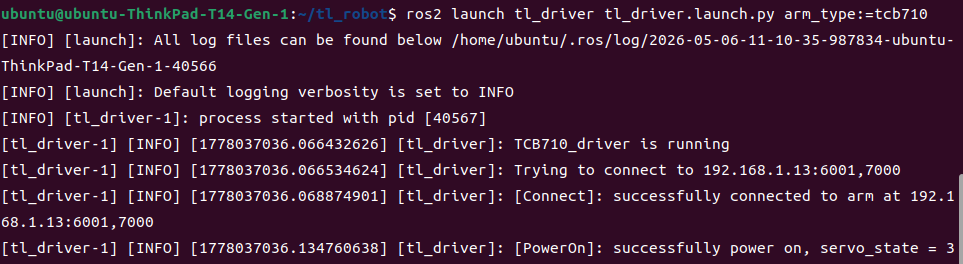
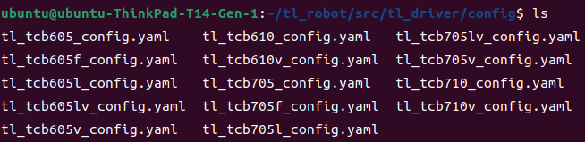
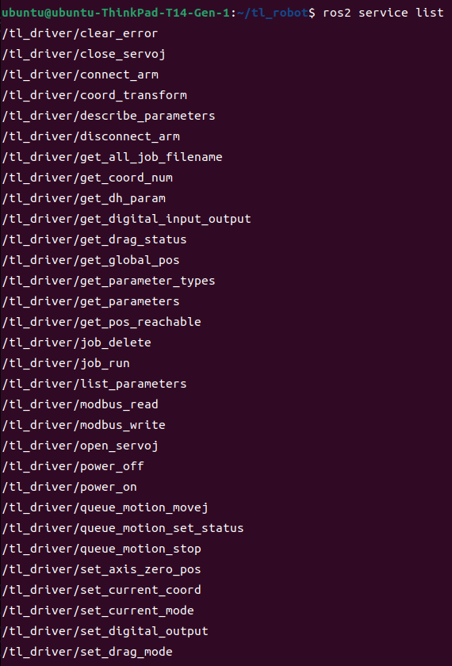
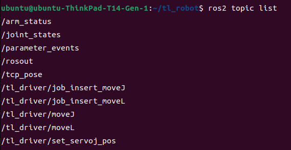

<div align="center">

# 天链机器人tl_driver使用说明书

</div>

## 目录
* 1.[tl_driver功能包说明](#tl_driver功能包说明)
* 2.[tl_driver功能包使用](#tl_driver功能包使用)
* 3.[tl_driver功能包架构说明](#tl_driver功能包架构说明)
* 4.[tl_driver功能包接口说明](#tl_driver功能包接口说明)

## tl_driver功能包说明
tl_driver功能包在机械臂ROS2功能包中是十分重要的，该功能包实现了通过ROS与机械臂进行通信控制机械臂的功能，在下文中将通过以下几个方面详细介绍该功能包。  
* 1.功能包使用。  
* 2.功能包架构说明。  
* 3.功能包话题说明。

通过这三部分内容的介绍可以帮助大家：  
* 1.了解该功能包的使用。  
* 2.熟悉功能包中的文件构成及作用。  
* 3.熟悉功能包相关的话题，方便开发和使用  
## tl_driver功能包使用
### tl_driver功能包编译

```bash
cd ~/tl_robot_ros2_cpp
colcon build
source install/setup.bash
```
编译完成后我们可以通过以下命令直接启动节点，连接机械臂。

### 启动方式

tl_driver 提供两种启动方式：

**方式一：通用启动（推荐开发调试使用）**

通过 `tl_driver.launch.py` 传入 `arm_type` 参数，适用于快速切换不同臂型：

```bash
ros2 launch tl_driver tl_driver.launch.py arm_type:=<arm_type>
```

**方式二：快捷启动（推荐日常使用）**

每种臂型都有对应的专用 launch 文件，无需传参，直接启动：

| 臂型 | 启动命令 |
|------|----------|
| TCB605 | `ros2 launch tl_driver tl_tcb605_driver.launch.py` |
| TCB605F | `ros2 launch tl_driver tl_tcb605f_driver.launch.py` |
| TCB605L | `ros2 launch tl_driver tl_tcb605l_driver.launch.py` |
| TCB605LV | `ros2 launch tl_driver tl_tcb605lv_driver.launch.py` |
| TCB605V | `ros2 launch tl_driver tl_tcb605v_driver.launch.py` |
| TCB610 | `ros2 launch tl_driver tl_tcb610_driver.launch.py` |
| TCB610V | `ros2 launch tl_driver tl_tcb610v_driver.launch.py` |
| TCB705 | `ros2 launch tl_driver tl_tcb705_driver.launch.py` |
| TCB705F | `ros2 launch tl_driver tl_tcb705f_driver.launch.py` |
| TCB705L | `ros2 launch tl_driver tl_tcb705l_driver.launch.py` |
| TCB705LV | `ros2 launch tl_driver tl_tcb705lv_driver.launch.py` |
| TCB705V | `ros2 launch tl_driver tl_tcb705v_driver.launch.py` |
| TCB710 | `ros2 launch tl_driver tl_tcb710_driver.launch.py` |
| TCB710V | `ros2 launch tl_driver tl_tcb710v_driver.launch.py` |

> 以下文档示例均以 **TCB710** 为例进行说明，其他臂型操作方式相同。

### 示例：启动 TCB710 机械臂

```bash
ros2 launch tl_driver tl_tcb710_driver.launch.py
```

### 指定机械臂 IP 启动

默认 IP 为 config 文件中的 `192.168.1.13`。若机械臂 IP 不同，可直接在启动指令后追加 `arm_ip:=<IP>` 覆盖（优先于 config 文件，无需修改配置）：

```bash
ros2 launch tl_driver tl_tcb710_driver.launch.py arm_ip:=192.168.1.100
```

通用 launch 同样支持：

```bash
ros2 launch tl_driver tl_driver.launch.py arm_type:=tcb710 arm_ip:=192.168.1.100
```

启动成功后，将显示以下画面:

  
当机械臂IP被改变后我们的启动指令就失效了，再直接使用如上指令就无法成功连接到机械臂了，我们可以通过修改如下配置文件，重新建立连接。
该配置文件位于我们的tl_driver功能包下的config文件夹下，需要根据不同的机械臂型号修改相应的配置文件。
以 TCB710 为例，配置文件为 `config/tl_tcb710_config.yaml`：

  
其配置文件内容如下:
```
tl_driver:   
  ros__parameters:  
    #robot param  
    arm_ip: "192.168.1.13"          # 设置TCP连接时的IP  
    arm_port: "6001"                # 设置TCP连接时的端口  
    arm_port_aux: "7000"            # 设置机械臂连接时的辅助端口
    arm_type: "TCB710"              # 机械臂型号（仅作日志标识，不参与行为）
    arm_joints: ["joint1", "joint2", "joint3", "joint4", "joint5", "joint6", "joint7"] # 关节名称（1～7 个，启动时校验）
    executor_threads: 8             # 执行器线程数，范围 1～64；默认 max(4, min(hardware_concurrency, 8))
    state_stream_interval_ms: 10    # 连续状态流间隔，范围 10～60000 ms
    joint_dynamics_rate: 10.0       # /tl_driver/joint_dynamics 频率，0=关闭
    joint_thermal_rate: 1.0         # /tl_driver/joint_thermal 频率，0～1，0=关闭
    motion_action_timeout: 60.0     # move_joint/move_linear 默认超时，秒
    track_action_timeout: 600.0     # play_track 默认超时，秒
```

> `arm_port` / `arm_port_aux` 以字符串传给 SDK，不要写成整数。
> 所有参数只在启动时读取（运行期 `ros2 param set` 会被明确拒绝并返回原因）。
> `/joint_states`、`/tcp_pose` 由 7000 帧通知直接发布，频率取决于 `state_stream_interval_ms` 与控制器的实际推送率；`/arm_status` 在每次 10 Hz 运行状态查询成功后发布。状态流在上下电完成后启动，启动失败则驱动启动失败；运行期若控制器停止推帧，对应话题停更，需要重启驱动恢复（无同步查询回退、无看门狗重试）。
## tl_driver功能包架构说明
### 功能包文件总览
```
├── CMakeLists.txt                 # 编译规则文件
├── config                         # 机械臂配置文件
│   ├── tl_tcb605_config.yaml
│   ├── tl_tcb605f_config.yaml
│   ├── tl_tcb605l_config.yaml
│   ├── tl_tcb605lv_config.yaml
│   ├── tl_tcb605v_config.yaml
│   ├── tl_tcb610_config.yaml
│   ├── tl_tcb610v_config.yaml
│   ├── tl_tcb705_config.yaml
│   ├── tl_tcb705f_config.yaml
│   ├── tl_tcb705l_config.yaml
│   ├── tl_tcb705lv_config.yaml
│   ├── tl_tcb705v_config.yaml
│   ├── tl_tcb710_config.yaml
│   └── tl_tcb710v_config.yaml
├── doc                            # 相关文档与图片
│   ├── tl_driver1.png
│   ├── tl_driver2.png
│   ├── tl_driver3.png
│   ├── tl_driver4.png
│   └── tl_driver接口说明书.md        # 服务、话题、Action 与参数逐条说明
├── launch                         # 启动文件
│   ├── tl_driver.launch.py        # 通用启动（需传arm_type参数）
│   ├── tl_tcb605_driver.launch.py
│   ├── tl_tcb605f_driver.launch.py
│   ├── tl_tcb605l_driver.launch.py
│   ├── tl_tcb605lv_driver.launch.py
│   ├── tl_tcb605v_driver.launch.py
│   ├── tl_tcb610_driver.launch.py
│   ├── tl_tcb610v_driver.launch.py
│   ├── tl_tcb705_driver.launch.py
│   ├── tl_tcb705f_driver.launch.py
│   ├── tl_tcb705l_driver.launch.py
│   ├── tl_tcb705lv_driver.launch.py
│   ├── tl_tcb705v_driver.launch.py
│   ├── tl_tcb710_driver.launch.py
│   └── tl_tcb710v_driver.launch.py
├── lib                            # SDK 库（V3.1.0，预编译，不可修改）
│   ├── arm                        # ARM 架构
│   │   └── libtl_host.so
│   ├── include                    # C/C++ API 头文件（扁平结构）
│   │   ├── tl_admittance.h
│   │   ├── tl_api.h
│   │   ├── tl_clamp.h
│   │   ├── tl_constant_force.h
│   │   ├── tl_dexterous_hands.h
│   │   ├── tl_force.h
│   │   ├── tl_interface.h
│   │   ├── tl_io.h
│   │   ├── tl_job_operate.h
│   │   ├── tl_modbus.h
│   │   ├── tl_queue_operate.h
│   │   ├── tl_servo_ext.h
│   │   ├── tl_track.h
│   │   └── tl_types.h
│   └── x86                        # x86 架构
│       └── libtl_host.so
├── package.xml
├── README.md
├── src                        # 驱动代码源文件（按职责拆分）
│   ├── tl_driver_main.cpp     # 进程入口：rclcpp 初始化 + 多线程执行器
│   ├── arm_sdk.hpp            # SDK 头文件唯一入口（libtl_host.so 的 API 头）
│   ├── arm_client.{hpp,cpp}   # SDK 薄封装：返回值文本化、错误回调、7000 口状态帧通道
│   ├── arm_session.{hpp,cpp}  # 会话：双端口连接、上下电
│   ├── node                     # 节点层
│   │   ├── driver_node.{hpp,cpp}  # DriverNode：参数、回调组、实体创建与服务/话题注册
│   │   ├── registrars.hpp       # 注册函数声明（服务域 + 话题）
│   │   ├── actions_motion.cpp   # action server（move_joint/move_linear/play_track）
│   │   ├── publishers.{hpp,cpp} # 状态流/诊断话题发布
│   │   ├── services_session.cpp # 会话类服务（连接/上下电/清错）
│   │   ├── services_state.cpp   # 状态类服务（库版本/当前模式）；状态量改由话题发布
│   │   ├── services_config.cpp  # 配置类服务（DH 查询/关节参数/工具/坐标系/可达性）
│   │   ├── services_transform.cpp # 坐标系服务（坐标系变换、当前坐标系读写）
│   │   ├── services_motion.cpp  # 运动类服务（速度/点动/轨迹/队列/ServoJ 开关）
│   │   ├── services_io.cpp      # IO 类服务（数字 IO、Modbus）
│   │   ├── topics.cpp           # 话题订阅（servoJ 目标位置）
│   │   └── publishers.{hpp,cpp} # StatePublishers：位姿/状态与诊断话题发布
│   ├── convert/msg_convert.{hpp,cpp} # ROS 消息 ↔ SDK 结构转换与参数校验
│   ├── convert/state_frame.{hpp,cpp} # 7000 端口状态帧 JSON 解析
│   └── version.hpp.in         # 版本号模板，构建时由 CMake 生成 tl_driver/version.hpp
└── test                       # 测试
    ├── test_all_interfaces.py   # 全接口测试脚本
    ├── test_units.cpp           # 单位换算单元测试
    ├── test_msg_convert.cpp     # 消息转换单元测试
    └── tl_driver_接口测试.md    # 接口测试说明文档
```
## tl_driver功能包接口说明
tl_driver功能包的服务、话题与 action 较多，可以通过如下指令了解其接口信息。

  
  
主要为套用API实现的一些机械臂本体的功能，其详细介绍和使用在此不详细展开，可以通过专门的文档《[tl_driver接口说明书](doc/tl_driver接口说明书.md)》进行查看。

状态话题化后，`/joint_states` 与 `/tcp_pose` 默认由 7000 端口 ACS/MCS 连续流驱动；诊断量走 `/tl_driver/joint_dynamics`、`/tl_driver/joint_thermal`，数字 IO 读写统一使用 `get_digital_input_output` / `set_digital_output` 服务（不发布 `io_state` 话题）。`/arm_status` 额外携带 1 Hz 查询缓存的 `speed` / `speed_valid`。长运动客户端使用 `/tl_driver/move_joint`、`/tl_driver/move_linear`、`/tl_driver/play_track` action（`track_playback` 服务已删除）；action 的 cancel 因 SDK 无停止接口而一律拒绝。
